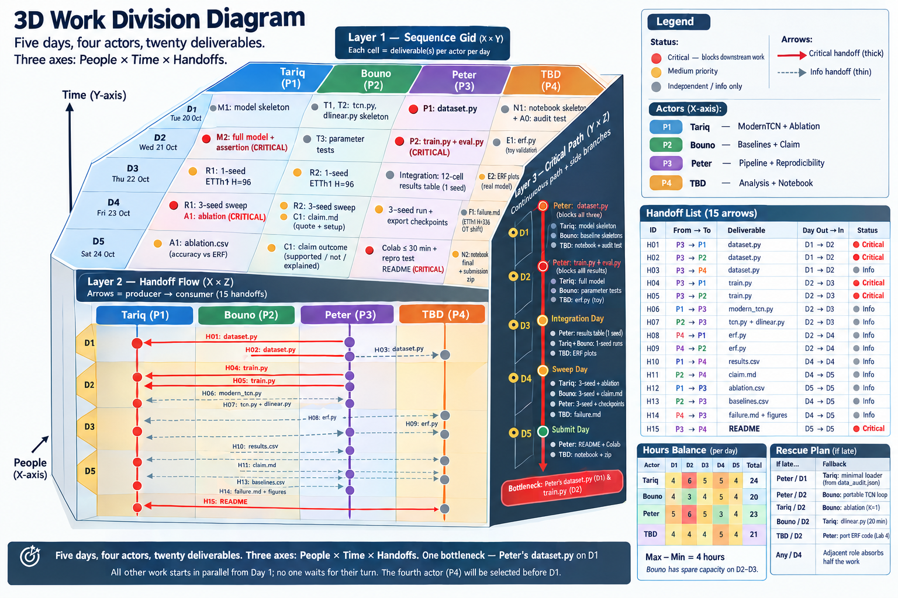

# ModernTCN — Large Kernels Instead of Dilation

## 📊 Project Plan: 3D Work Division

> **Status:** Work in Progress. Data audit and model architectures (`tcn.py`, `modern_tcn.py`) are implemented.

## Structure
- `models/`: PyTorch implementations of TCN and ModernTCN.
- `scripts/`: Data audit and parameter counting scripts.
- `logs/`: JSON artifacts.
